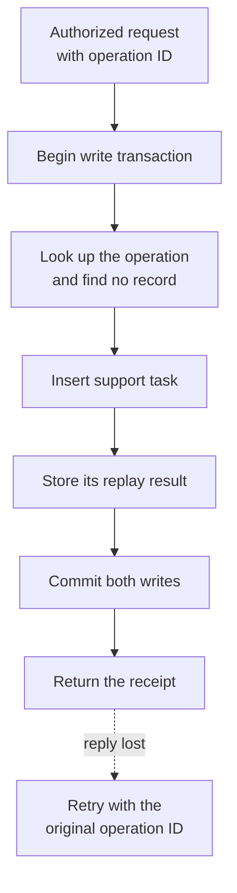

# Tool calls that can be retried safely


The support task was created. The response never arrived.

From the caller's side, that looks much like a request that never reached the service. Retrying might finish the work, or create a second task. A timeout cannot tell the caller which situation it is in.

An agent adds another way to repeat the action. It might call the tool again after seeing an error, regenerate a call during a resumed conversation, or restart after a worker fails. I would design the tool boundary to tolerate those repetitions before adding retry instructions to the prompt.

The [companion implementation](https://github.com/subodhjena/retry-safe-tool-calls) creates local support tasks in SQLite. It deliberately loses a response after committing, then retries the same request. No messages, payments, or external API calls are involved.

## A transport attempt is not the business operation

Suppose someone asks support to check a delayed delivery. Creating the support task is one logical operation. Sending that request three times should still refer to that one operation.

A different request tomorrow might have exactly the same subject. That can be a legitimate second task. Hashing the arguments and treating every matching hash as a duplicate would collapse two separate requests.

This distinction is central to [AWS's account of idempotent APIs](https://aws.amazon.com/builders-library/making-retries-safe-with-idempotent-APIs/): callers supply a request identifier to express intent, rather than requiring the service to infer intent from identical parameters.

For an agent tool, I would have the application allocate an operation ID and persist it with the approved action. Every transport attempt for that action reuses it. A provider's tool-call identifier can still be recorded for tracing, but I would not assume a regenerated call will receive the same identifier.

| Identifier            | What it identifies             | Changes on retry?                |
| --------------------- | ------------------------------ | -------------------------------- |
| Business operation ID | One intended action            | No                               |
| Transport attempt ID  | One delivery attempt           | Yes                              |
| Model tool-call ID    | A call in a model exchange     | Depends on the exchange          |
| Created resource ID   | The support task that resulted | No, for replay of that operation |

The business operation ID belongs in durable application state. Keeping it only in the current worker's memory loses the connection when that worker restarts.

## State the tool's contract

“Idempotent” needs a scope. [HTTP semantics](https://www.rfc-editor.org/rfc/rfc9110.html#section-9.2.2) defines the property in terms of the intended effect of repeated requests. It does not require every log entry or response to be identical, and it does not make an arbitrary POST safe to repeat.

For this example, the contract is deliberately narrow:

1. The key is the pair `(tenant, operation_id)`.
2. The same key and arguments return the stored creation result.
3. The same key with different arguments produces a conflict.
4. A new key can create a second task, even with the same subject.
5. The task and the successful operation record commit together.

The caller must already be authorized for the tenant. An idempotency key is not a credential, and knowing somebody else's key must not reveal their result. Authorization belongs before this function is called, including on replay.

The function also hashes a canonical representation of the arguments, including the tool name and payload version. The hash detects changed intent under an existing key. It does not replace the caller-supplied key.

## Remember the result in the same transaction

A deduplication check followed by a separate write leaves a race:

```text
worker A: key absent
worker B: key absent
worker A: create task
worker B: create another task
```

Writing the operation record first, then creating the task outside its transaction, has a different failure: the record can survive while the task does not. Reversing those writes can leave a task without its replay record.

In the companion, both tables belong to one SQLite database. A write transaction covers the lookup, the task insertion, and the stored response. The unique key on the operations table supplies a durable identity constraint. Here is the creation path for a new operation. A replay reads the existing result instead; changed arguments leave through a rollback.



The implementation uses `BEGIN IMMEDIATE`. [SQLite's transaction documentation](https://sqlite.org/lang_transaction.html) explains that this starts a write transaction immediately; another writer can make it fail with `SQLITE_BUSY`. The example waits up to five seconds for the lock. That makes the concurrency test practical, but it is not a claim about throughput or a production timeout policy.

The relevant write path is small:

```python title="operations.py"
task_id = db.execute("INSERT INTO tasks (tenant, subject) VALUES (?, ?)",
                     (tenant, subject)).lastrowid
response = {"task_id": task_id, "status": "created"}
db.execute("INSERT INTO operations VALUES (?, ?, ?, ?)",
           (tenant, operation_id, digest, json.dumps(response, sort_keys=True)))
```

Both inserts occur inside the same explicit transaction. The complete function checks for a previous result before this block, rolls back on failure, and closes the connection. A process-local dictionary would not preserve the same property across new connections or restarts.

## Make the lost response reproducible

The demonstration commits the transaction, raises a timeout instead of returning, and calls the function again through a new connection. Run it with Python 3.11 or later:

```bash
python3 -m unittest -v
python3 operations.py
```

The captured output is:

```text title="sample-output.txt"
Committed, but response was lost
After timeout: tasks=1 operations=1
Retry: {"status": "created", "task_id": 1}
After retry: tasks=1 operations=1
Conflict: Same operation ID used with different arguments
```

Seven tests cover the lost response, rollback before commit, changed arguments, separate intents with matching subjects, tenant scope, invalid input, and concurrent delivery. Sixteen calls from eight threads return one result and leave one task. That is a local concurrency check, not a load test.

The [tested revision](https://github.com/subodhjena/retry-safe-tool-calls/tree/9c1a87d0af45ed63ee2436b552d7e36c6aec5626) includes the complete implementation and tests. Failure injection raises exceptions at chosen boundaries; it does not simulate power loss, a damaged disk, or a distributed database failover.

### A replay result is a receipt

The stored response says the task was created. It does not promise the task still has its original status.

If another worker closes that task before a retry arrives, the replay should not create a replacement. Return the original operation result, then use a separate read for current resource state when needed. This keeps “what happened to my request?” separate from “what is true about the task now?”

The example retains operation records indefinitely. A real service needs an explicit retention and expiry contract. Once a key is forgotten, a late retry may look like a new operation. A caller that has passed the documented retry window should reconcile the outcome rather than silently issue the same action under a fresh key.

Provider contracts also differ. [Stripe's API v1 idempotency documentation](https://docs.stripe.com/api/idempotent_requests) describes replaying saved status and body, including certain failures, and permits pruning keys after at least 24 hours. That is a specific API contract, not a sensible default for every tool. Check the API version, scope, retention period, argument-mismatch behavior, and which failures are saved.

## A local transaction cannot cover an external effect

Replacing the task insertion with a call to an email or payment provider changes the problem. The remote action does not participate in this SQLite transaction.

If the provider succeeds and the process fails before recording that success locally, replaying the local operation can repeat the remote action. Holding the database lock across the network request does not remove that gap.

For an external write, I would look for a downstream idempotency contract and persist its key before dispatch. An outbox can durably record work that still needs delivery. It does not, by itself, prevent duplicate effects at the receiver. The receiving service still needs a way to recognize redelivery, or the workflow needs a reconciliation path.

Where neither is available, “outcome unknown” is a real state. Keep the operation ID, request details, attempt history, and any provider reference. Resolve that uncertainty before telling the model to try again with a new identity. A human may need to inspect the external system.

This is also why I would avoid describing the example as “exactly once.” It demonstrates one local effect per retained key within one database. It does not establish that property across arbitrary external services.

## Bound the retry policy too

Being safe to repeat does not make repetition free. A retry consumes connections, queue capacity, provider quota, and somebody's deadline.

[AWS's guidance on timeouts and jitter](https://aws.amazon.com/builders-library/timeouts-retries-and-backoff-with-jitter/) explains how retries can amplify load during an outage. For a tool boundary, I would choose one layer to own the retry budget, cap attempts within an overall deadline, and spread eligible retries with backoff and jitter. Validation failures and changed-intent conflicts should return to the caller for correction.

The application should classify the result before returning it to the agent:

| Result                                           | Next action                                                  |
| ------------------------------------------------ | ------------------------------------------------------------ |
| Confirmed success                                | Return the recorded result                                   |
| Retryable transport failure, protected operation | Retry with the same operation ID within budget               |
| Invalid request or changed intent                | Correct the request; do not loop                             |
| Outcome unknown without duplicate protection     | Reconcile or escalate                                        |
| Retry window expired                             | Check the original outcome before creating another operation |

That classification belongs in code with a documented contract. The prompt can explain it, but the prompt cannot make two independent writes atomic.

Before connecting a write tool, I would ask one concrete question: if the effect happens and the reply disappears, what will the next attempt find? The answer should be something the service can look up and enforce.

---

Article snapshot prepared 17 October 2026. The [website article](https://subodhjena.com/blog/tool-calls-that-can-be-retried-safely) is canonical; code and fixtures are maintained in this repository. Examples prepared and run on 17 October 2026.
